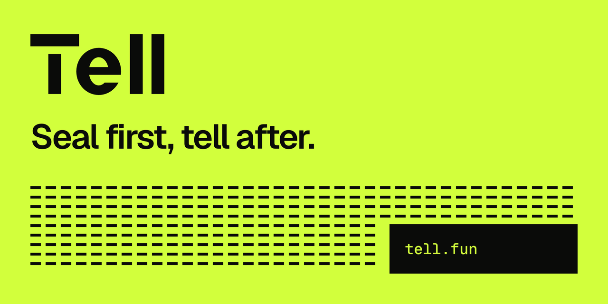
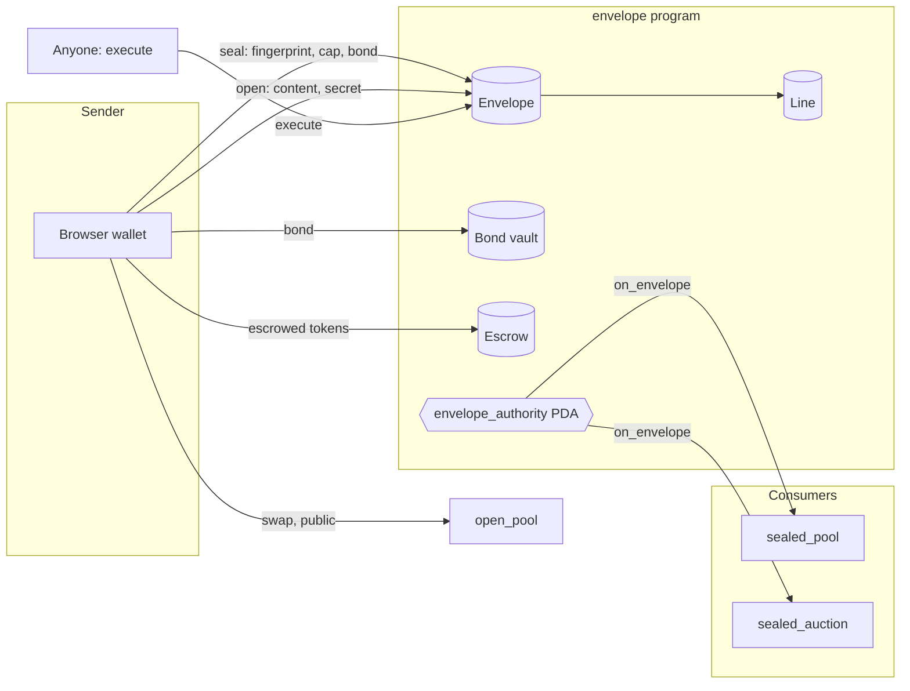
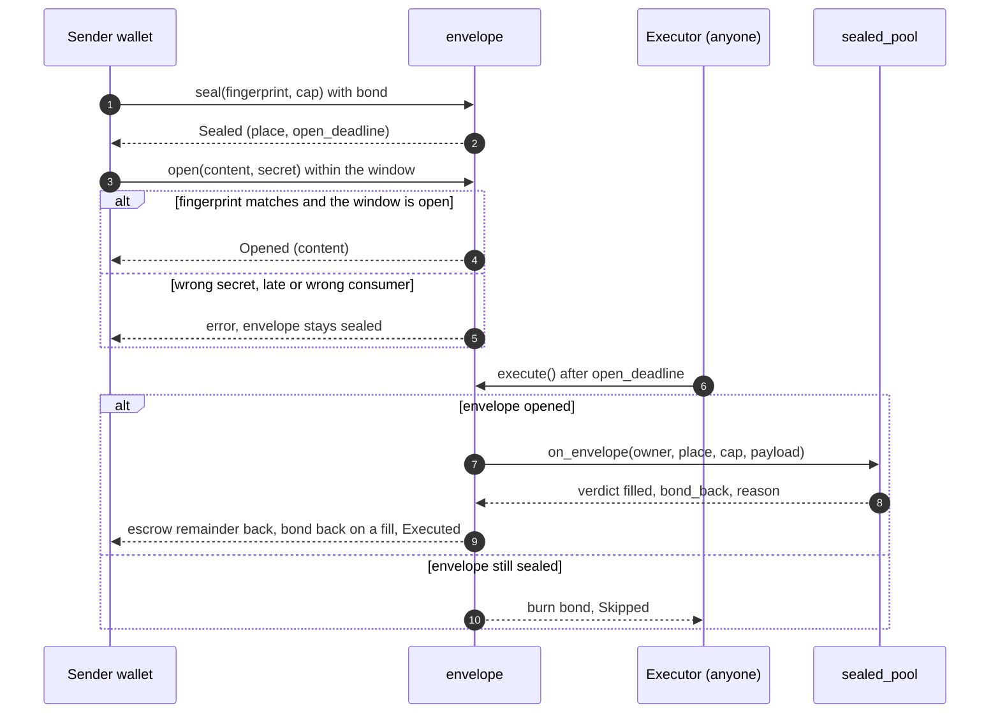
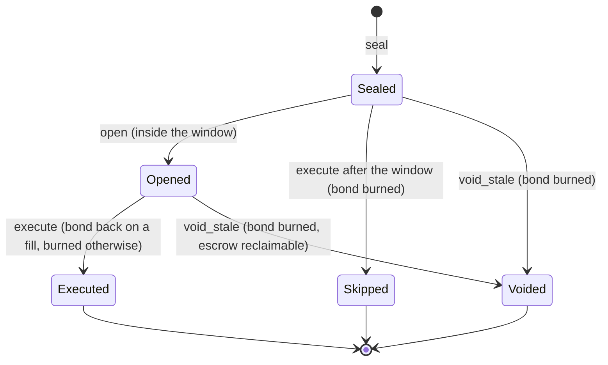
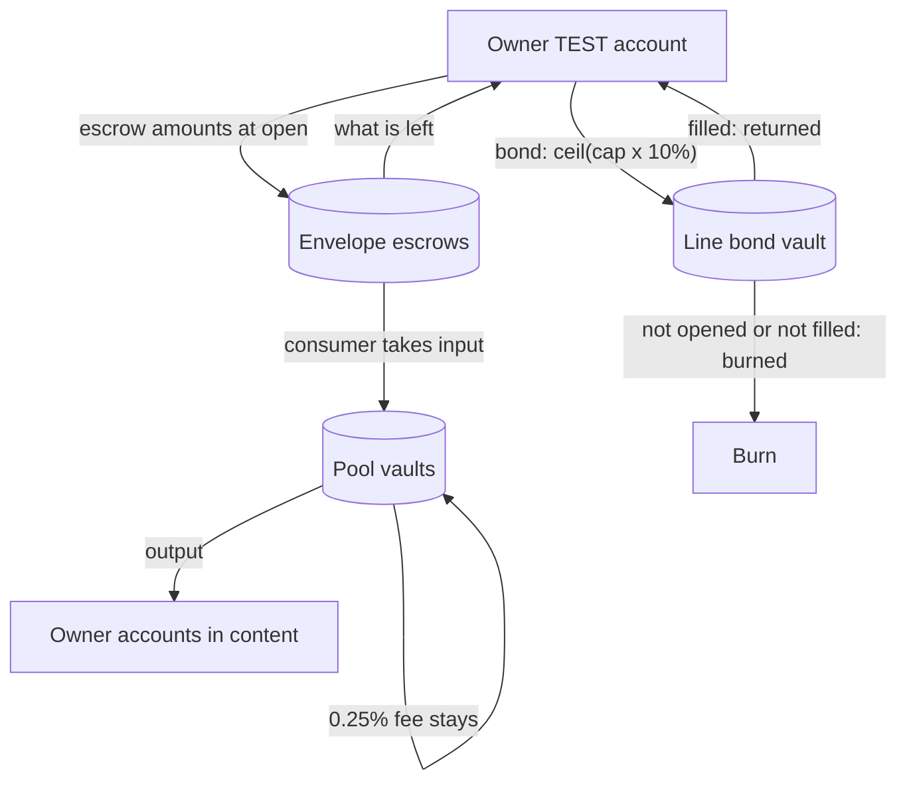

<p align="center"></p>

# Tell

<p>
  <a href="https://tell.fun"></a>
  <a href="https://x.com/tellchain"></a>
  <a href="https://github.com/tellchain/tell"></a>
  <a href="https://github.com/tellchain"></a>
  <a href="docs/whitepaper.md"></a>
  <a href="docs/GENESIS.md"></a>
  <a href="VERIFY.md"></a>
  <a href="SECURITY.md"></a>
  <a href="bots/README.md"></a>
  <a href="LICENSE"></a>
  <a href="https://github.com/tellchain/tell/actions/workflows/ci.yml"></a>
</p>

<p><strong>CA:</strong> <code>TELLbUhH3mroXH5xtgGorT7eeFaVfzAiJkwQTbMvuWc</code></p>

**Seal first, tell after. The place in line of a sealed order is fixed first, and the order opens only afterwards.**

## Overview

Tell is its own network, built from Solana's engine Agave. It is not on Solana mainnet. A sender submits only the fingerprint of an order, with a public cap on its size and a bond. The envelope program gives that fingerprint the next place in line. Once the place is final, the sender opens the order, and execution follows the line. An order sent through an envelope cannot be read by anyone before its place in line is final.

There is no key committee and no secure chip. The sender seals and the sender opens, and the browser wallet does both. No key can change the programs: all four are in the chain's genesis with no upgrade authority, so nobody, the project included, can replace their code. No key can move an envelope's escrow or bond except along the program's own paths: back to the sender, into the consumer the sender named, or burned when the order is not opened or not filled (an outbid auction bid keeps its bond).

This repository holds the four programs and their tests, the JavaScript client the website, the tests and the bots use, the IDLs, the project's bots and measuring scripts, the three patches applied to Agave v3.0.9, the genesis configuration, and the count script behind the network's checkable number. The chain runs on faucet test money today.

- Programs: envelope `jkhaCtRjHFmw1E6fZVL3MdR2dBjka1Rh1cEufFE5mGF`, sealed_pool `D1nuiLpfLrhm5qbMaLUdb2cLaAYWgCPDEXWaw2KE4Un7`, open_pool `HxzVrsgrfeYXmdjT5cxsZBaj6z4WdQMqQjTp8Z7EN957`, sealed_auction `CWvRXgP4d9QGZFEt1DBEBnpECtUEW5F1hRD1QKbZ5YMH` (on the Tell chain)
- Tests: 13 protocol tests (`VERIFY.md`)

## Programs

| Program | Address on the Tell chain | Role |
| --- | --- | --- |
| envelope | `jkhaCtRjHFmw1E6fZVL3MdR2dBjka1Rh1cEufFE5mGF` [](https://solscan.io/account/jkhaCtRjHFmw1E6fZVL3MdR2dBjka1Rh1cEufFE5mGF?cluster=custom&customUrl=https://rpc.tell.fun) | Lines, envelopes, bonds and escrows; `seal`, `open`, `execute` |
| sealed_pool | `D1nuiLpfLrhm5qbMaLUdb2cLaAYWgCPDEXWaw2KE4Un7` [](https://solscan.io/account/D1nuiLpfLrhm5qbMaLUdb2cLaAYWgCPDEXWaw2KE4Un7?cluster=custom&customUrl=https://rpc.tell.fun) | Constant-product pool reachable only through envelopes |
| open_pool | `HxzVrsgrfeYXmdjT5cxsZBaj6z4WdQMqQjTp8Z7EN957` [](https://solscan.io/account/HxzVrsgrfeYXmdjT5cxsZBaj6z4WdQMqQjTp8Z7EN957?cluster=custom&customUrl=https://rpc.tell.fun) | The same pool with public entries, kept beside it for comparison |
| sealed_auction | `CWvRXgP4d9QGZFEt1DBEBnpECtUEW5F1hRD1QKbZ5YMH` [](https://solscan.io/account/CWvRXgP4d9QGZFEt1DBEBnpECtUEW5F1hRD1QKbZ5YMH?cluster=custom&customUrl=https://rpc.tell.fun) | Lots whose bids are sealed in a line and opened after the close |

The addresses are fixed on the local validator and on the network alike. The links open Solscan pointed at the Tell chain's public RPC (a custom cluster), not at Solana. Read them with the stock CLI against the public RPC listed on [https://tell.fun/verify](https://tell.fun/verify).

## How it works

1. **Seal.** The wallet builds the order, makes a 32-byte secret and sends `seal(fingerprint, cap)`. The fingerprint is `sha256("blindfold:v1" || line || owner || u32_le(len) || content || secret)`; the domain tag `blindfold:v1` is a fixed constant of the deployed programs, kept from the project's working name, since changing it would change every fingerprint. The program moves a bond of 10% of the public cap into the line's bond vault and gives the envelope the place `line.next_place`.
2. **Wait for the place.** The place is final once the seal is confirmed. Up to this point the chain holds a fingerprint, a cap and a bond, and nothing of the content.
3. **Open.** In the open window, the slots after the sealing slot that the line sets (12 on the main pair SLAB/TEST, 4 on the first pool ORE/TEST), the wallet sends `open(content, secret)`. The program recomputes the fingerprint from the bytes it receives, checks that the content names the line's consumer, and moves the escrowed amounts from the owner's associated token accounts into envelope escrow accounts. The content names no accounts: every account a consumer touches is checked by key from its own state and the owner.
4. **Execute.** After the window, anyone may call `execute()`. It only ever takes the envelope at `line.next_execute`, then adds one. An opened envelope calls the consumer's `on_envelope` with the line's envelope authority as signer; the consumer returns its verdict, what is left in the escrows goes back to the owner, and the bond returns only on a fill (in an auction also when outbid).
5. **Skip or burn.** An envelope that is still sealed when its turn comes is skipped, and its bond is burned. An opened order that is not filled (slippage, cap exceeded, below reserve, a bad payload) also loses its bond, so sealing both sides and walking away from one costs money. `void_stale()` lets anyone move the cursor past an envelope still at the head of the line once `stale_slots` (9,000 on the project's lines) have passed since its own window or since the cursor last moved, whichever is later, burning its bond, so no envelope can hold a line forever.
6. **Count.** `scripts/line-order.mjs` reads blocks with plain JSON-RPC (`getBlocks`, `getBlock`) and checks that every sealed-pool line ran its places 0, 1, 2, ... with none repeated or missing.

A consumer never fails on a business condition (slippage, a cap exceeded, a reserve not met, an outbid bid). It takes nothing, emits its result event with `filled = false` and a reason code, and returns its verdict `[filled, bond_back, reason]` as return data, so one order can never stop the line. A wrong account key from the cranker fails only that transaction; the line does not move, and the next correct `execute` runs it.

## Architecture



The envelope program owns the lines, the envelopes, the bond vault and the escrows. Each line has its own envelope authority PDA `["authority", line]`; it is the only signer a consumer accepts, so a consumer only ever holds its own line's signer. The open pool has public entries and no line.



One order from seal to execute. Steps 1 and 3 are the sender's two transactions; the wallet sends both. Step 7 is permissionless: the project's executor calls it every slot it has work, and anyone else may too.



The envelope's `state` field holds 0 sealed, 1 opened, 2 executed, 3 skipped, 4 voided. Envelopes are kept after execution, so the record of every place stays on chain.



Where tokens move. The bond is taken at seal; the escrows exist only between open and execute. After the consumer call, what remains in each escrow returns to the owner's associated token account (re-created if the owner closed it), and the escrow is closed with its rent going to the cranker.

| Account | Seeds | Holds |
| --- | --- | --- |
| Line | `["line", market]` | consumer, bond mint and rate, open window, next place, execute cursor, counters |
| Envelope | `["envelope", line, u64_le(place)]` | owner, fingerprint, cap, bond, slots, state, opened content |
| Bond vault | `["bond_vault", line]` | the bonds of the line's envelopes until each one executes, is skipped or is voided |
| Escrow | `["escrow", envelope, u8(index)]` | tokens of one opened envelope until execute |
| envelope_authority | `["authority", line]` | no data; signs consumer calls, owns the vault and escrows |
| Config (each pool) | `["config"]` | the registrar key that may create pools |
| Pool (each pool) | `["pool", base_mint, quote_mint]` | vaults, LP mint, line, fee, opener, locked seed liquidity |
| Pool vault | `["vault", pool, mint]` | the pool's reserves |
| LP mint | `["lp", pool]` | liquidity shares, 6 decimals |
| Lot | `["lot", seller, u64_le(lot_id)]` | lot, reserve, close slot, line, best bid and bidder, state |

## Repository structure

```
programs/
  envelope/        lines, seal, open, execute, void_stale, reclaim_escrow
  sealed_pool/     create_pool, on_envelope (swap, add and remove liquidity)
  open_pool/       create_pool, swap, add_liquidity, remove_liquidity
  sealed_auction/  list_lot, on_envelope (bid), settle
    src/lib.rs           declare_id! and the entry points
    src/instructions/    one file per instruction: accounts and handler
    src/state/           account structs
    src/errors.rs        error codes
    src/events.rs        events
bots/              executor, liquidity, comparison and auction workers; measurement scripts
client/index.js    ids, PDAs, OrderContent, fingerprint, instruction builders
idl/               the four IDLs
tests/             protocol flow tests and local fixtures
scripts/
  build.sh         builds the programs and IDLs
  local-validator.sh      local validator with the programs at their fixed ids
  line-order.mjs   the count script of the checkable number
patches/           the three patches applied to Agave v3.0.9
docs/GENESIS.md    engine source, patches, genesis programs, validators
docs/whitepaper.md the whitepaper source: what runs, what has been measured, how to check it
```

- `programs/envelope/src/instructions/execute.rs` holds the cursor rule: `execute` takes only the envelope whose place equals `line.next_execute`.
- `client/index.js` is the one place the fingerprint preimage and the `OrderContent` encoding are written in JavaScript; the tests, the website and the bots all use it.
- `bots/` contains Tell's public workers, and `bots/measure/` the scripts behind the seal-to-execute and sandwich records; see `bots/README.md`.

## Quick start

Requirements: Rust 1.95.0, Solana CLI 3.0.0 (Agave), SBF platform tools v1.52, Anchor CLI 0.31.1, Node.js 22 or newer.

```bash
npm ci
bash scripts/build.sh
bash scripts/local-validator.sh &
npm test
npm --prefix bots ci
npm --prefix bots run typecheck
```

These are the commands `VERIFY.md` records: 13 protocol tests. The count script runs against any RPC of the chain:

```bash
node scripts/line-order.mjs --rpc <rpc> --from 0
```

Its last line is `value=<K>`, the number of envelopes executed out of line order. Sealing an order with the client:

```js
import * as C from "./client/index.js";

const secret = C.randomSecret();
const { ix } = await C.sealIx(programs, { owner, line, content, secret, cap });
```

## Security

See `SECURITY.md` for how to report a vulnerability.

Enforced by the programs:

- `execute` only takes the envelope at the line's cursor, so places execute 0, 1, 2, ... in each line.
- `open` is accepted only in the slots after the sealing slot up to `open_deadline`, and only when the fingerprint recomputed from the received bytes matches.
- The sealed pool has no public swap, add or remove; it accepts only its own line's envelope authority as signer.
- A consumer never fails on a business condition, so one order cannot stop its line.
- A mint with a freeze authority is refused for bonds, escrows and pools, so a frozen account cannot stop execute.
- The content names no accounts; each consumer checks every account by key, so nothing a cranker chooses changes an outcome.
- The bond is 10% of the public cap (at least 1 TEST); it returns only on a fill, or when an auction bid is outbid.
- Auction bids open only after the lot closes, in the reveal window (750 slots by default), so no bid is readable while bidding is open.
- `void_stale` keeps a line from being held: once `stale_slots` have passed since an envelope's window and since the cursor last moved, anyone can void it at the cursor; `stale_slots` is bounded to 150..=216,000 per line.
- The sealed pool prices from reserves it books in its own state, so tokens sent straight to a vault do not move the price.
- The native SOL mint is refused as a bond or escrow mint and in the sealed pool.
- `open` takes a fixed deposit from the owner (four token-account rents, in the chain's native coin) that goes to whoever executes or voids the envelope and is never refunded; it covers any associated token account re-created at execute.

### Trust assumptions

- **Upgrade authority:** none on all four programs, installed in genesis. A fix ships as a new program.
- **Admin:** each pool program has a registrar key that may create pools and hand the registrar role to another key. It cannot touch reserves, envelopes, escrows or bonds.
- **What no key can move:** escrowed tokens and bonds. They leave only along the program's paths: into the consumer the opened content names, back to the owner's associated token accounts, or burned for an order that was not opened or not filled; an outbid auction bid gets its bond back. Pool reserves move only through swaps and liquidity changes.
- **Validators:** all four validators are run by the project. Ordering inside a block is the engine's; the line rule is a rule of the programs, not of the engine.
- **Pending feed.** The website relays submitted orders. Open orders expose their direction and amount. Envelopes expose their commitment, cap and bond. Direct RPC transactions follow the validators’ ordering rules.
- **Selective opening.** A sender can abandon a commitment after placing it. An expired commitment loses its bond. Bond costs depend on market conditions.
- **Dependencies:** Agave v3.0.9 with the three patches in `patches/`; the SPL Token, Token-2022, Associated Token Account and Memo programs shipped with it; Anchor 0.31.1. No oracle and no outside venue: the pools price only from their own reserves.
- **Money:** the chain runs on faucet test money. No coin on it is real money.
- **Audit:** the programs have not had an external audit. The tests are not an audit.

## Source history

This repository imported a source snapshot on November 27, 2026. The snapshot came without its original Git history. The first 133 commits present the code in dependency order. Their author and committer dates use an illustrative schedule from August 24 to November 24, 2026. The lockfiles retain the November 25 snapshot date. The remaining commits use the recorded file-save and verification times from the November 27 publication work.

## License

MIT. See `LICENSE` for the terms.
